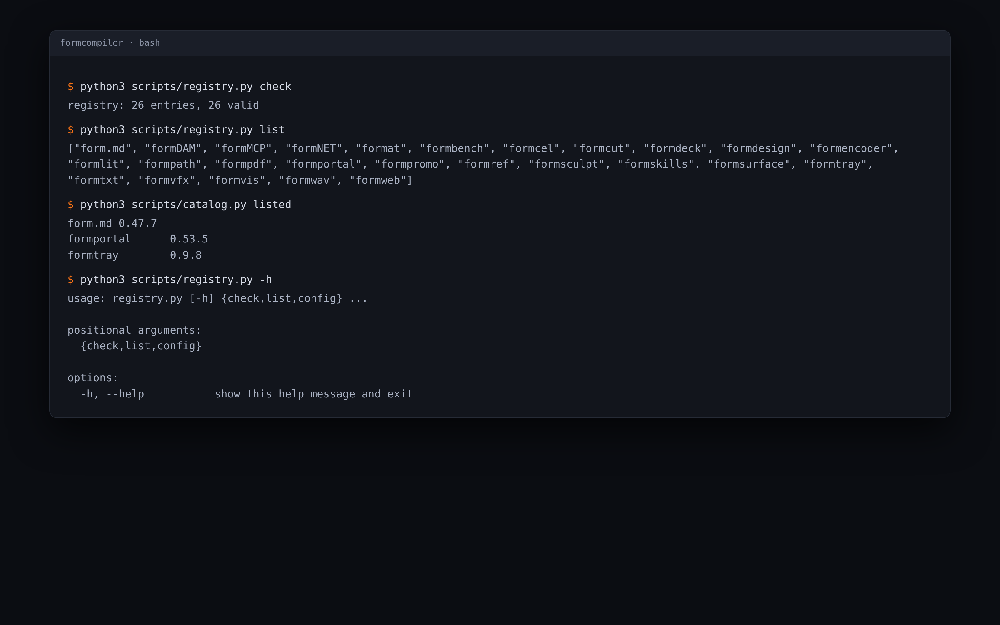

<p align="center">
  
</p>

<h1 align="center">FormCompiler</h1>

<p align="center">
  <b>Build and release; where every Form app is built, signed and shipped.</b><br>
  Push a compile branch, get a draft release on every platform,<br>
  plus the signed catalogue FormPortal reads. GitHub Actions and Python.
</p>

<p align="center">
  
  
  
  
  
  
</p>

<p align="center">
  <a href="https://formcompiler.formai.studio/"><b>FormCompiler on formai.studio</b></a> ·
  <a href="https://github.com/nodemode-dev/formcompiler/releases">Latest release</a> ·
  <a href="#run-it-from-source">Run it from source</a> ·
  <a href="#the-form-family">All Form apps</a>
</p>

<br>

<p align="center">
  
  <br>
  <sub>The registry check passing for 26 apps, and the three apps the catalogue lists today.</sub>
</p>

<p align="center">
  <a href="#features">Features</a> ·
  <a href="#everything-in-the-box">In the box</a> ·
  <a href="#under-the-hood">Under the hood</a> ·
  <a href="#where-releases-come-from">Releases</a> ·
  <a href="#run-it-from-source">Run from source</a> ·
  <a href="#the-form-family">Form family</a>
</p>

<br>

<table>
  <tr>
    <td width="25%" valign="top">
      <h3>One place</h3>
      Every Form app is built, signed and released here; the app repositories only run their checks.
    </td>
    <td width="25%" valign="top">
      <h3>Push to release</h3>
      Push <code>compile_vX.Y.Z</code> from main, or a tag, and get a draft release on every platform the app lists.
    </td>
    <td width="25%" valign="top">
      <h3>Checked first</h3>
      Branch, commit, version and the app's own checks must pass before anything builds.
    </td>
    <td width="25%" valign="top">
      <h3>Signed in one place</h3>
      Apple, Windows and updater keys are FormCompiler secrets; no app repository holds one.
    </td>
  </tr>
</table>

<br>

## Features

- **No secrets in the apps.** FormCompiler watches the app repositories itself, so no app holds a token for it.
- **Checked before it builds.** The ref name, the commit on main, a version above the highest published one, the version file and the app's check workflows.
- **Drafts, never surprises.** A stable release is a draft a person publishes; a published release is never overwritten.
- **Betas publish themselves.** A prerelease version becomes a GitHub prerelease once its builds pass.
- **Yank, never delete.** A version in `yanked.json` leaves the catalogue; its files stay in place.
- **Skills in every release.** Each release carries `form-app.json` and a reproducible `<app>-skills-v<version>.zip`.
- **Pinned actions.** Every third-party action is pinned to a full commit SHA.

## Everything in the box

<table>
  <tr>
    <td width="33%" valign="top">
      <h4>26 registered apps</h4>
      One <code>apps/&lt;app&gt;.json</code> each: version source · checks · platforms · toolchain · build commands · extra jobs · assets · update files · catalogue entry
    </td>
    <td width="33%" valign="top">
      <h4>4 workflows</h4>
      watch · release · desktop-release · self-check
    </td>
    <td width="33%" valign="top">
      <h4>Platforms</h4>
      macos-arm64 · macos-x64 · linux-x64 · linux-arm64 · windows-x64 · windows-arm64 · plus phone apps, tarballs, Flatpak, servers and a container image per app
    </td>
  </tr>
</table>

## Under the hood

- **Language:** 19 Python scripts on the standard library; `cryptography` only signs the catalogue.
- **Contract:** [`docs/REGISTRY.md`](docs/REGISTRY.md) defines the registry file every app writes.
- **Flow:** `watch.yml` runs hourly (`17 * * * *` UTC) or on demand, `release.yml` gates and builds, and a draft `<app>-vX.Y.Z` opens here.
- **Channels:** `X.Y.Z` is stable; anything with `-beta.N` or `-rc.N` is beta and never touches `<app>-updates`.
- **Publishing:** the download store, update feeds, catalogue signature and yanks run in a private companion pipeline, [FormPipe](https://github.com/nodemode-dev/formpipe).
- **Tested:** 281 tests in 13 files (registry, versions, watch, triggers, tauri config, signing, workflow guards).

## Where releases come from

Every build of every Form app is released on this repository's [releases page](https://github.com/nodemode-dev/formcompiler/releases). Users install them with [FormPortal](https://github.com/nodemode-dev/formportal) or from each app's page on formai.studio.

```
app repo: bump version, push compile_v1.96.5 from main (or tag v1.96.5)
  -> watch.yml: refuse a bad ref or failed check, else start release.yml
  -> release.yml: desktop, extras, image, then draft <app>-v1.96.5
  -> FormPipe (private): catalogue, update feeds, download store
```

Public files are served from https://dl.formai.studio as `<app>/<version>/<file>`, with the catalogue at `catalog/apps.json` and `catalog/apps.json.sig`.

## Run it from source

FormCompiler has no UI and no app to install. Run its scripts to check the registry or see what the watch would start.

**Requires:** Python 3.11+ and git. `watch.py --dry-run` also needs a `GH_TOKEN`.

```sh
git clone git@github.com:nodemode-dev/formcompiler.git
cd formcompiler
python3 scripts/registry.py check     # validate every registry file
python3 scripts/catalog.py listed     # apps and versions in releases.json
python3 scripts/watch.py --dry-run    # what the watch would start (needs GH_TOKEN)
```

To release an app, run this in its repository after the version bump is on main, then publish the draft that appears here:

```sh
git push origin main:refs/heads/compile_v1.96.5
```

If a release run fails for a runner reason, use **Re-run failed jobs** in Actions, never **Re-run all jobs**.

Secrets (`FORMCOMPILER_APP_TOKEN`, `APPLE_*`, `AZURE_*`, `TAURI_SIGNING_PRIVATE_KEY`, `FORMPIPE_DISPATCH_TOKEN`) are all optional; without them macOS builds are signed ad hoc and Windows builds are unsigned.

> [!IMPORTANT]
> **Status:** in use. Only three apps are in the catalogue so far (form.md, FormPortal, FormTray). See [`CHANGELOG.md`](CHANGELOG.md).

**Contributing:** branch from `main`, keep changes to the registry and scripts here, and leave app code to the app repositories. Packaging and releases live in FormCompiler. See [`AGENTS.md`](AGENTS.md).

## Repository

| Path | What it is |
|---|---|
| `apps/` | One registry file per app |
| `scripts/` | The Python scripts the workflows run |
| `.github/workflows/` | watch, release, desktop-release, self-check |
| `docs/`, `tests/` | Registry contract and accounts notes; the pytest suite |
| `releases.json`, `yanked.json` | The catalogue and the versions left out of it |

Docs: [`docs/REGISTRY.md`](docs/REGISTRY.md), [`SECURITY.md`](SECURITY.md) · Agents: [`CLAUDE.md`](CLAUDE.md), [`AGENTS.md`](AGENTS.md)

## The Form family

FormCompiler is one of the **Form apps**: native creative tools that install, update and roll back through FormPortal and can all be driven by agents.

| | App | What it's for | Download | Code |
|:-:|---|---|---|---|
|  | **form.md** | Documents, databases and realtime editing together | [formai.studio](https://formmd.formai.studio/) | [GitHub](https://github.com/nodemode-dev/form.md) |
|  | **FormAT** | Chat and agent workspace on your key | [formai.studio](https://format.formai.studio/) | [GitHub](https://github.com/nodemode-dev/format) |
|  | **FormCAD** | Drafting, parametric parts and NURBS surfaces | | [GitHub](https://github.com/nodemode-dev/formCAD) |
|  | **FormCel** | Spreadsheets agents can read and edit | [formai.studio](https://formcel.formai.studio/) | [GitHub](https://github.com/nodemode-dev/formcel) |
|  | **FormCraft** | Generate images, video, audio, 3D and worlds | | [GitHub](https://github.com/nodemode-dev/formcraft) |
|  | **FormCut** | Multi-track video editing with no upload | [formai.studio](https://formcut.formai.studio/) | [GitHub](https://github.com/nodemode-dev/formcut) |
|  | **FormDAM** | Photo library and asset manager | [formai.studio](https://formdam.formai.studio/) | [GitHub](https://github.com/nodemode-dev/formDAM) |
|  | **FormDeck** | Presentations and pitch decks | [formai.studio](https://formdeck.formai.studio/) | [GitHub](https://github.com/nodemode-dev/formdeck) |
|  | **FormDesign** | Page layout for print and the web | [formai.studio](https://formdesign.formai.studio/) | [GitHub](https://github.com/nodemode-dev/formdesign) |
|  | **FormEncoder** | Media encoding queue with presets | [formai.studio](https://formencoder.formai.studio/) | [GitHub](https://github.com/nodemode-dev/formencoder) |
|  | **FormFabric** | Sewing patterns draped with cloth simulation | | [GitHub](https://github.com/nodemode-dev/formfabric) |
|  | **FormLit** | Photo library and raw development | [formai.studio](https://formlit.formai.studio/) | [GitHub](https://github.com/nodemode-dev/formlit) |
|  | **FormMorpheus** | Frame-by-frame and performed animation | | [GitHub](https://github.com/nodemode-dev/formmorpheus) |
|  | **FormNET** | See what your computer sends online | | [GitHub](https://github.com/nodemode-dev/formNET) |
|  | **FormPath** | Vector illustration with artboards and type | [formai.studio](https://formpath.formai.studio/) | [GitHub](https://github.com/nodemode-dev/formpath) |
|  | **FormPDF** | Edit, redact, sign and fill PDFs | [formai.studio](https://formpdf.formai.studio/) | [GitHub](https://github.com/nodemode-dev/formpdf) |
|  | **FormPromo** | Promo films from your own media | [formai.studio](https://formpromo.formai.studio/) | [GitHub](https://github.com/nodemode-dev/formpromo) |
|  | **FormRef** | Reference boards for creative work | [formai.studio](https://formref.formai.studio/) | [GitHub](https://github.com/nodemode-dev/formref) |
|  | **FormRig** | Rig, skin and retarget any mesh | | [GitHub](https://github.com/nodemode-dev/formrig) |
|  | **FormSculpt** | 3D sculpting, remeshing and painting | [formai.studio](https://formsculpt.formai.studio/) | [GitHub](https://github.com/nodemode-dev/formsculpt) |
|  | **FormSurface** | Texture painting with PBR export | [formai.studio](https://formsurface.formai.studio/) | [GitHub](https://github.com/nodemode-dev/formsurface) |
|  | **FormTools** | Viewers, batch tools and file utilities | | [GitHub](https://github.com/nodemode-dev/formtools) |
|  | **FormTxt** | Word processing with .docx round trips | [formai.studio](https://formtxt.formai.studio/) | [GitHub](https://github.com/nodemode-dev/formtxt) |
|  | **FormVFX** | Motion graphics and VFX compositing | [formai.studio](https://formvfx.formai.studio/) | [GitHub](https://github.com/nodemode-dev/formvfx) |
|  | **FormVis** | Layered image editing with local AI | [formai.studio](https://formvis.formai.studio/) | [GitHub](https://github.com/nodemode-dev/formvis) |
|  | **FormWav** | Multitrack audio editing and mixing | [formai.studio](https://formwav.formai.studio/) | [GitHub](https://github.com/nodemode-dev/formwav) |
|  | **FormWeb** | Visual website building with a CMS | [formai.studio](https://formweb.formai.studio/) | [GitHub](https://github.com/nodemode-dev/formweb) |
|  | **FormPortal** | Install, update and roll back Form apps | [formai.studio](https://formportal.formai.studio/) | [GitHub](https://github.com/nodemode-dev/formportal) |
|  | **FormTray** | One dock icon for every app | [formai.studio](https://formtray.formai.studio/) | [GitHub](https://github.com/nodemode-dev/formtray) |
|  | **FormMCP** | One MCP connection to the family | [formai.studio](https://formmcp.formai.studio/) | [GitHub](https://github.com/nodemode-dev/formMCP) |
|  | **FormSkills** | Every app's agent skills in one place | [formai.studio](https://formskill.formai.studio/) | [GitHub](https://github.com/nodemode-dev/formskills) |
|  | **FormBench** | Parity, testing and rankings for the family | [formai.studio](https://formranker.formai.studio/) | [GitHub](https://github.com/nodemode-dev/formbench) |
|  | **FormSlot** | Codebase memory for coding agents | | [GitHub](https://github.com/nodemode-dev/formslot) |
|  | **SubForm** | Workbench for parallel Claude Code agents | | [GitHub](https://github.com/nodemode-dev/subform) |
|  | **FormCompiler** | Builds, signs and releases every app | [formai.studio](https://formcompiler.formai.studio/) | [GitHub](https://github.com/nodemode-dev/formcompiler) |
|  | **FormPipe** | Release pipeline and update feeds | | [GitHub](https://github.com/nodemode-dev/formpipe) |

---

## Maintainers

| Maintainer | Role |
|---|---|
| [@nodemode-ai](https://github.com/nodemode-ai) | Owner |
| [@gbarnai](https://github.com/gbarnai) | Co-owner |

Code owners are set in [`.github/CODEOWNERS`](.github/CODEOWNERS).

## License

FormCompiler is licensed under the GNU General Public License v3.0 only ([`LICENSE`](LICENSE), SPDX `GPL-3.0-only`). Copyright 2026 NodeAgentc, Inc. Third-party notices: [`NOTICE`](NOTICE).
