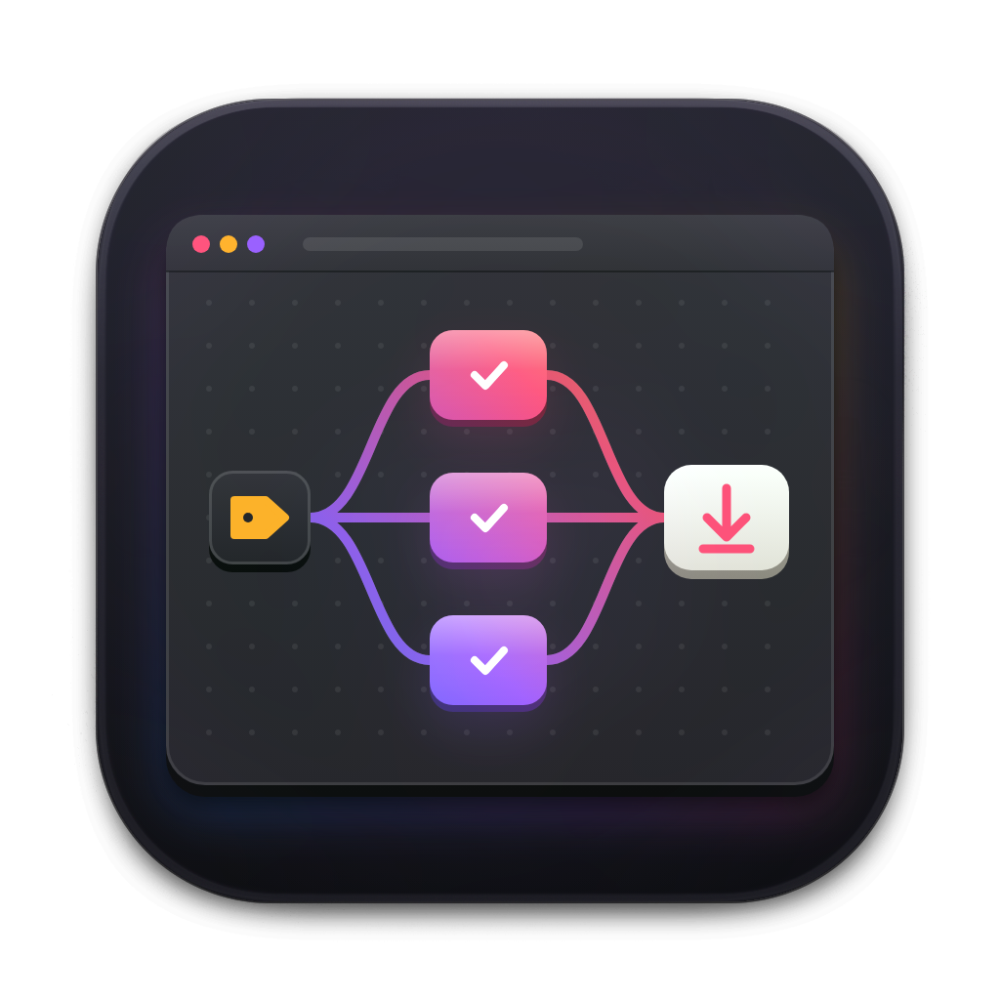

<p align="center"></p>

<h1 align="center">formcompiler</h1>

<p align="center"><b>The one place every form* app is built, signed and released: push a compile branch, get a draft release.</b></p>

<p align="center">
  
  
  
  
</p>

## What it is

formcompiler builds and releases the form* apps (formvis, formcut, formwav, formdesign, form.md and the rest). The app repositories build nothing: they run their checks, and that is all. When an app is ready to ship, a maintainer pushes a branch named `compile_vX.Y.Z` cut from main's head, or, for an app whose registry entry sets `tag_trigger`, a tag `vX.Y.Z` on a commit already on main. formcompiler notices it, checks it, builds the app on every platform the app lists, signs it with the identities only formcompiler holds, and opens a draft release `vX.Y.Z` on the app's own repository, at the gated commit. The app repository owns its Releases page; formcompiler is the factory and the gate, and keeps no app release. Publishing the draft there hands the release to a private companion pipeline, which refreshes the app's update feed and the family catalogue FormPortal reads, on GitHub and in the public download store at https://dl.formai.studio. A prerelease (`X.Y.Z-beta.N`) publishes itself to the beta channel.

Each app is described by one registry file, `apps/<app>.json`: how to read its version, which checks must pass, its platforms, toolchain, build commands, extra jobs (phone apps, a riscv64 tarball, a Flatpak, server binaries, a container image), release assets, update files and its catalogue entry. The contract is [docs/REGISTRY.md](docs/REGISTRY.md).

**Stack:** GitHub Actions · Python 3 standard library scripts (`cryptography` only to sign the catalogue) · **Scale:** 25 registered apps (24 enabled), 4 workflows, 18 scripts

## Highlights

- **No secrets in the apps** formcompiler watches the app repositories itself, so no app holds a token for it
- **Every hour, or now** `watch.yml` runs on a schedule (`17 * * * *`, UTC) and from the Run workflow button; with nothing new it makes one or two API calls per app
- **Checked before anything builds** the branch or tag name, the commit is on main, the version is above the app's highest published one in its channel (a stable above the highest stable, a beta above everything), the version file at that commit agrees, and the app's own check workflows concluded `success` on that commit
- **Releases live with the app** every release is on the app's repository, tagged `vX.Y.Z` at the gated commit, with its installers, `SHA256SUMS.txt`, `form-app.json` and, for a Tauri-updater app, `latest.json`; the one credential that writes there belongs to the `release` environment and is held only by the `publish` job, which runs no app code: the files are assembled in a job without it
- **Drafts, never surprises** every stable release of a `release: draft` app is a draft a maintainer publishes on the app's repository; a published release is never overwritten, a rebuilt draft is refreshed in place, a newer version replaces an older draft, and one release run per app runs at a time
- **Betas publish themselves** a prerelease version is published as a GitHub prerelease once its builds pass, and lands in the catalogue's beta channel
- **Public downloads** the files, the update feed and the signed catalogue are copied to the download store at https://dl.formai.studio by a private companion pipeline, and the catalogue points there, with the same sizes and SHA-256
- **Yank, never delete** a version listed in `yanked.json` is left out of the catalogue; the release and its files stay on the app's repository
- **Signing in one place** the Apple Developer ID, notarization and Windows signing through Azure Artifact Signing are formcompiler secrets and variables; until they are set, macOS builds are signed ad hoc and Windows builds are unsigned
- **One catalogue for the family** `releases.json` on main, mirrored to the `catalog` release as `apps.json` and, with the catalogue key, `apps.json.sig`, in FormPortal's `apps.schema.json` shape
- **Skills and MCP in every release** each release carries `form-app.json` (what the app offers agents) and `<app>-skills-v<version>.zip` (its `.claude/skills`, byte-reproducible), and the catalogue carries both with their digests, so formskills and formMCP read released skills with no step in any app
- **Provenance** the publish job attests `SHA256SUMS.txt` with `actions/attest-build-provenance` before the draft is made, so the publishing pipeline can prove a release on an app repository came from this workflow (`gh attestation verify SHA256SUMS.txt --repo nodemode-dev/formcompiler --signer-workflow nodemode-dev/formcompiler/.github/workflows/release.yml`) and then checks every file against the sums
- **Pinned actions** every third-party action is pinned to a full commit SHA; actionlint is checksum-verified in the self-check

## How a release flows

```
app repo                                  formcompiler
  bump the version on main                  watch.yml (every hour, or Run workflow)
  push compile_v1.96.5 from main's head,      for every app in apps/*.json:
  or tag v1.96.5 on main (tag_trigger)          find compile_v* branches, and the newest v* tag
  the app's checks run on that commit           skip what is published, drafted, superseded or running
                                                refuse a ref off main, a version not above the
                                                  highest published, a wrong version, a failed check
                                                wait while checks run
                                                start release.yml for the newest ready ref of each app
                                            release.yml (one run per app at a time)
                                              gate: the same rules again
                                              desktop: every platform (desktop-release.yml)
                                              extras: phone apps, tarballs, Flatpak, servers
                                              image: the container image, when listed
                                              release files: SHA256SUMS.txt, form-app.json, latest.json,
                                                the notes (no credential; the app's own scripts run here)
                                              publish job (release environment, formcompiler's checkout only):
                                                attest SHA256SUMS.txt (provenance for the pipeline)
                                                draft v1.96.5 on the app's repository, at that commit
                                                delete the app's older drafts there
                                              a beta (1.97.0-beta.1): publish it as a prerelease
                                                and tell the publishing pipeline (app, tag, repository)
                                            the publishing pipeline (private; a person publishes,
                                                      a beta, a yank, or its hourly check)
                                              build the catalogue from every app repository's releases
                                              copy every listed release to the download store,
                                                checked against SHA256SUMS.txt
                                              <app>-updates: latest.json and update files (stable only)
                                              the catalog release, the store's update feed and catalogue
                                              releases.json and yanked.json on main by pull request
```

The download store is laid out as:

| Path | What | Cache-Control |
| --- | --- | --- |
| `<app>/<version>/<file>` | every file of a published release, SHA256SUMS.txt among them | `public, max-age=31536000, immutable` (never overwritten) |
| `<app>/updates/<file>` | latest.json and the registry's `updater.files` (stable releases only) | `public, max-age=60` |
| `catalog/apps.json`, `catalog/apps.json.sig` | the signed catalogue | `public, max-age=60` |

The catalogue's artifact and skills URLs are `<base>/<app>/<version>/<file>` under `FORMCOMPILER_PUBLIC_BASE`, and the update feed's latest.json points at the same versioned paths. Without a base, everything stays on GitHub.

Channels follow the version: `X.Y.Z` is stable, anything with a prerelease part (`-beta.N`, `-rc.N`) is beta. A beta is published by formcompiler and never touches `<app>-updates`; a stable release waits as a draft for a person to publish it, and a beta does not replace a stable draft.

## Quick Start

### Release an app

From the app's repository, after the version bump is on main:

```shell
git switch main && git pull
git push origin main:refs/heads/compile_v1.96.5
```

or, for an app whose registry entry sets `tag_trigger`, a tag on a commit already on main (lightweight or annotated):

```shell
git tag -a v1.96.5 -m "formvis 1.96.5" && git push origin v1.96.5
```

The next watch run (within the hour, or **Actions, watch, Run workflow** here) starts the build. Review the draft on the app's own Releases page, then publish it: that is the approval, and it creates the `vX.Y.Z` tag at the gated commit (an app with `tag_trigger` already has it; a `vX.Y.Z` tag that already points elsewhere refuses the release). A release asset is at most 2 GB, GitHub's limit; a file above it fails the draft.

If a release run fails because of formcompiler or the runner rather than the app, open the run in Actions and use **Re-run failed jobs**, never **Re-run all jobs**: the platforms that already built keep their files, and only the failed ones build again. The watch never restarts a failed run by itself.

A second push to the same branch rebuilds and refreshes the draft. A version that is not above the app's highest published version in its channel is refused; bump the version to release again. A stable fix (1.5.1) can still ship while a beta (1.6.0-beta.1) is out. Betas work the same way (`compile_v1.97.0-beta.1` or `v1.97.0-beta.1`) and are published by formcompiler as soon as they build.

### Yank a release

A version is yanked by adding it to `yanked.json` (app, version, a one-line reason, the date) through a pull request; the private publishing pipeline opens it. Once merged, the catalogue is rebuilt without it, signed and published. The release and its files stay on the app's repository, nothing deletes a release, and the version still counts as published, so the fix ships as a higher version. The update feed is not changed: an app's updater still offers the yanked version until the higher one is published.

### Add an app

Write `apps/<app>.json` from [docs/REGISTRY.md](docs/REGISTRY.md), add `'compile_v*'` to the push branches of the app's check workflow, then:

```shell
python3 scripts/registry.py check
python3 scripts/registry.py config --app <app>
```

### Run the scripts by hand

```shell
python3 scripts/registry.py check                          # validate every registry file
python3 scripts/watch.py --dry-run                         # what the watch would start (needs GH_TOKEN)
FORMCOMPILER_PUBLIC_BASE=https://dl.formai.studio python3 scripts/catalog.py build --out releases.json   # with store URLs
python3 scripts/plan.py --platforms macos-arm64,linux-x64  # from an app's root: version, tag vX.Y.Z, matrix
python3 scripts/catalog.py build --out releases.json       # the catalogue from every app repository's published releases
python3 scripts/feed.py resolve --app formvis --tag v1.97.2  # the app, repository, title and channel of a release
python3 scripts/versions.py older-drafts --app formvis --version 1.97.2   # the app repository's drafts below a version
python3 scripts/catalog.py keygen                          # a catalogue key pair
python3 scripts/agents.py build --app formvis --app-dir ../formvis --dist out --version 1.97.2   # form-app.json and the skills archive
python3 scripts/agents.py check --app formvis --dist out    # validate them
```

## Configuration

Secrets and variables live in this repository at repository level, except the one that writes releases, which lives in the `release` environment (see [docs/ACCOUNTS.md](docs/ACCOUNTS.md)): an environment secret is not passed on by `secrets: inherit`, so the build jobs, which run the app's own scripts, never see it. Everything else is optional; without it builds are unsigned and published releases wait for the publishing pipeline's hourly check. Publishing to the download store and signing the catalogue happen in a private companion pipeline, which holds its own credentials; nothing about it is configured here.

| Secret | Purpose |
| --- | --- |
| `FORMCOMPILER_APP_TOKEN` | Read access to the app repositories while they are private (contents and actions, read only): checkouts, branches, tags, checks and the published releases. It lists no draft (GitHub shows drafts only to write access), so the watch and the gate do not see a waiting draft: the watch skips a commit whose release run already succeeded instead, and "superseded by a newer draft" is only applied in the `publish` job, which deletes the app's older drafts |
| `FORMCOMPILER_APP_ID`, `FORMCOMPILER_APP_PRIVATE_KEY` | In the `release` environment: a GitHub App installed on the nodemode-dev app repositories with Contents read and write. The `publish` job mints a token for the one repository it releases on (`actions/create-github-app-token`), creates or refreshes the draft, deletes older drafts and publishes a beta or a `release: publish` app. The App must be on the bypass list of the organisation ruleset that restricts `v*` tags |
| `FORMCOMPILER_WRITE_TOKEN` | In the `release` environment: the fallback when the App is not set, a fine-grained token with Contents read and write on the app repositories; its user must be on the same bypass list. With neither set the `publish` job fails and names docs/ACCOUNTS.md |
| `APPLE_CERTIFICATE`, `APPLE_CERTIFICATE_PASSWORD`, `APPLE_SIGNING_IDENTITY` | Developer ID signing of the macOS apps: the certificate is imported into a temporary build keychain before the build, so app scripts can sign their own engines w/ `APPLE_SIGNING_IDENTITY`, and every disk image is signed and notarized after the build |
| `APPLE_ID`, `APPLE_PASSWORD`, `APPLE_TEAM_ID` | Notarization of the macOS apps and disk images |
| `AZURE_CLIENT_ID`, `AZURE_CLIENT_SECRET`, `AZURE_TENANT_ID` | The sign-in formcompiler's Windows builds use for Azure Artifact Signing (role Artifact Signing Certificate Profile Signer on the signing account) |
| `WINDOWS_CERTIFICATE`, `WINDOWS_CERTIFICATE_PASSWORD` | A Windows code-signing certificate as a base64 .pfx; only certificates issued before June 2023 can be a .pfx, and Artifact Signing replaces it when its variables are set |
| `TAURI_SIGNING_PRIVATE_KEY`, `TAURI_SIGNING_PRIVATE_KEY_PASSWORD` | Signed updater bundles and `latest.json` |
| `FORMPIPE_DISPATCH_TOKEN` | Tells the publishing pipeline (`repository_dispatch` `formcompiler-published`, payload `app`, `tag` and `repository`) when release.yml publishes a beta or a publish-mode app; without it the pipeline's hourly check picks the release up |

| Variable | Purpose |
| --- | --- |
| `TAURI_UPDATER_PUBKEY` | The updater public key, written into each app's build when the private key is set |
| `FORMCOMPILER_PUBLIC_BASE` | Where the download store is served, `https://dl.formai.studio`; the desktop builds write each app's updater endpoint from it |
| `FORMCOMPILER_ATTEST` | Unset (the default) attests `SHA256SUMS.txt` in the publish job. `off` skips the attestation, only while this repository is private, since GitHub refuses attestations on a private repository without Enterprise; remove the variable once formcompiler is public, or the publishing pipeline cannot verify any release |
| `MSIX_IDENTITY_NAME`, `MSIX_PUBLISHER`, `MSIX_PUBLISHER_DISPLAY_NAME` | formvis's Microsoft Store package |
| `ARTIFACT_SIGNING_ENDPOINT`, `ARTIFACT_SIGNING_ACCOUNT`, `ARTIFACT_SIGNING_PROFILE` | The Azure Artifact Signing account's regional endpoint, account name and certificate profile; with them and the three `AZURE_` secrets set, every app whose registry says `"windows": "certificate"` is signed on Windows |

## Architecture

```
.github/workflows/
├── watch.yml             finds ready compile branches and tags and starts release.yml
├── release.yml           gate, desktop, extras, image, the release files, the draft on the app's repository
├── desktop-release.yml   the per-platform build (called by release.yml)
└── self-check.yml        actionlint, the registry, the scripts, the text rules
apps/                     one registry file per app
scripts/
├── registry.py           validates apps/*.json, emits the build config
├── github_api.py         the GitHub REST calls (standard library)
├── readiness.py          ready, wait, skip or refuse for one branch
├── watch.py              the watch over every app
├── gate.py               the same rules for one release run, against the app repository's releases
├── plan.py               version, tag, platform matrix
├── run_build.py          the app's build contract or its own commands, and post-build
├── tauri_config.py       the --config JSON: updater artifacts, keys, signing
├── stage.py              collects one platform's release files
├── agents.py             form-app.json v2 and the skills archive of a release
├── with_portal.py        app-plus-FormPortal downloads (registry with_portal)
├── release_assets.py     SHA256SUMS.txt and latest.json
├── release_credential.sh which credential the publish job writes with
├── notes.py              release notes from the app's CHANGELOG
├── feed.py               an app's release by its tag, its update files, store URLs in latest.json
├── versions.py           semver ordering, channels, vX.Y.Z tags, an app repository's published and draft versions
├── public_urls.py        download store URLs
├── yank.py               adds a version to yanked.json
└── catalog.py            FormPortal's catalogue, its signature and key pair
docs/REGISTRY.md          the registry contract
docs/ACCOUNTS.md          the family's GitHub app for FormPortal's sign-in, and the credential that writes the app releases
SECURITY.md               what formcompiler guards, against whom, and how to report a vulnerability
.github/CODEOWNERS        the paths the owner reviews
.github/dependabot.yml    grouped weekly updates, each release at least 7 days old
releases.json             the published catalogue (proposed by the publishing pipeline)
yanked.json               versions left out of the catalogue
```

## Status

v0.9.0: every app release is created on the app's own repository, tagged `vX.Y.Z` at the gated commit, by a credential from the `release` environment; the scripts read each app repository's releases, formpipe is told the app, the tag and the repository, and formcompiler keeps no app releases. The releases made here before v0.9.0 (`<app>-vX.Y.Z`) are not read any more: the owner recreates the ones that should stay in the catalogue on their app repositories, or deletes them. Not yet run in Actions.

v0.8.0: publishing to the download store, the catalogue signature, the update feeds and yanks move to a private companion pipeline; release.yml tells it about each release it publishes. This repository builds, signs and drafts releases, and keeps the registry, the scripts, `releases.json` and `yanked.json`.

Unreleased: the download store at https://dl.formai.studio, `vX.Y.Z` tags as triggers for apps with `tag_trigger`, the version-must-go-up rule, one release run per app with newer drafts replacing older ones, betas that publish themselves, the yank workflow, the watch every 15 minutes, and formpromo's registry entry. Tested with stubbed GitHub calls; not yet run in Actions or against the store.

v0.4.8: a test suite (`tests/`) runs in self-check.

v0.4.7: the bundle's README presents FormPortal as optional; nothing installs it for anyone.

v0.4.6: `with_portal` in a registry entry adds an app-plus-FormPortal download beside each desktop installer (`scripts/with_portal.py`, the release job's "App plus FormPortal" step); no entry turns it on yet. Tested against a stand-in catalogue, not yet run in Actions.

v0.4.5: FormRanker's entry declares its MCP server (`agents.mcp`), which FormRanker 0.8.0 serves over stdio as `formranker mcp`; `agents.py build` now writes `mcp` available in its `form-app.json`. No workflow or script changed.

v0.4.4: FormRanker is registered (`apps/formranker.json`, id `formranker`, kind `parity`, `prelaunch`), built from its own `build_app` and `build_app.bat` like formtray, with Python 3.13 for its frozen engine and its bundles under `src-tauri/target`. `scripts/registry.py check` passes for all 24 entries, and `agents.py build` makes its `form-app.json` (no skills, no MCP server until FormRanker 0.8.0). No workflow or script changed.

v0.4.3: `docs/ACCOUNTS.md` says how the family's GitHub OAuth app is registered for FormPortal's optional sign-in (FormPortal 0.47.0), and FormPortal's Linux build installs `libdbus-1-dev`.

v0.4.2: the catalogue's stable history keeps the five newest earlier releases plus the newest release of every older major line (`0.minor` while the major is 0), so FormPortal can offer previous major versions with no cutoff.

v0.4.1: formMCP (`apps/formMCP.json`, id `formmcp`) and formskills (`apps/formskills.json`, id `formskills`) are registered, built like formtray from their own `build_app`; both start as `prelaunch`. `scripts/registry.py check` passes for all 23 entries, and `agents.py build` makes both apps' `form-app.json` (formMCP with its skill and an MCP server, formskills with neither). No workflow or script changed.

v0.4.0: every release gets `form-app.json` v2 and the app's skills archive, and the catalogue carries both. Run by hand on formvis 1.97.1's checkout (4 skills, 42 files, reproducible) and on a sample release through `catalog.py`; the self-check runs the same on a sample. Not yet run on GitHub, and actionlint was not run on this change.

v0.3.3: the copyright holder in LICENSE, NOTICE and this README is NodeAgentc, Inc.; no workflow, script or registry file changed.

v0.3.2: formencoder's releases attach the LAME 3.100 source, checked against its pinned SHA-256, and a `delivery-tools-PLATFORM.txt` per platform listing the delivery tools staged in that bundle.

v0.3.1: registry changes from the family bundle audit. The macOS builds of formDAM, formlit, formvis, formpdf and formtxt build OpenCV from source without FFmpeg; Format and formcut get the MSVC environment on Windows for their LGPL PyAV build, and Format's releases attach the FFmpeg source. `scripts/registry.py check` passes; no workflow changed.

v0.3.0: every workflow and script is written, linted with actionlint and run by hand: the planner against all 20 enabled app repositories at their current versions, the watch and gate rules against those repositories with GitHub's API stubbed, the catalogue against FormPortal's schema and its signature against FormPortal's check. Nothing has run on GitHub yet; the first runs are the owner's, from the test plan in the planning sidecar. No signing identity is set yet.

If GitHub disables the scheduled watch after 60 days without activity in this repository, re-enable it under **Actions, watch**. Every published release commits `releases.json`, which counts as activity.

## Development

- `main` is the only branch; changes land as commits by `nodemode-ai <mackin@nodemode.ai>`, with no co-author or session trailers (see `CLAUDE.md`)
- Conventions: surgical edits only, no comments in code (context lives in [scripts/HASHOUT_LOG.md](scripts/HASHOUT_LOG.md)), no emojis anywhere, semver tags `v*.*.*`

## Contributors

- `Owner` · nodemode-ai

### Licensing

GPL-3.0-only. Copyright 2026 NodeAgentc, Inc. See [LICENSE](LICENSE) & [NOTICE](NOTICE).
